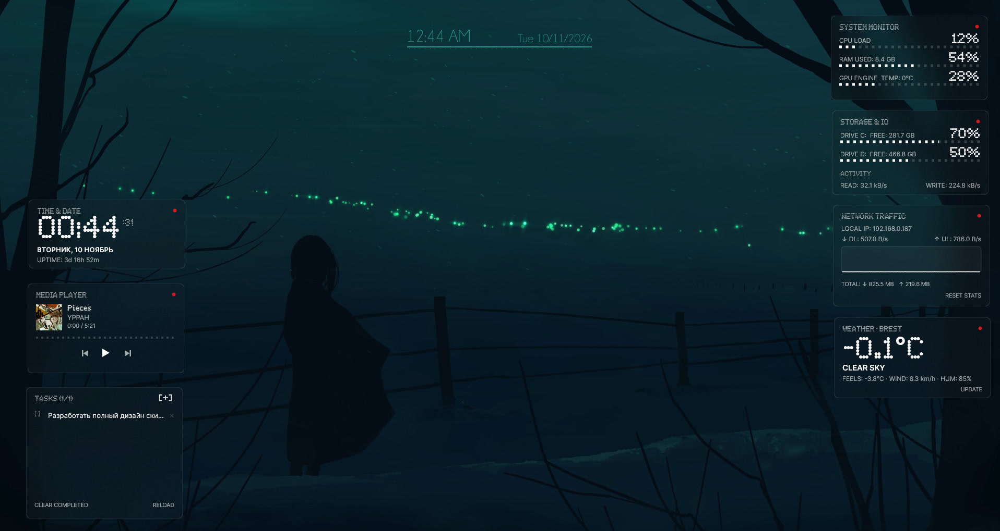

<div align="center">


# NOTHING TRANSPARENT SUITE

**A unified, ultra-minimalist Rainmeter desktop suite crafted in the authentic Nothing OS aesthetic.**

[](https://www.rainmeter.net/)
[](https://docs.rainmeter.net/manual/settings/rainmeter-section/#UseD2D)
[](LICENSE)
[](release/)
[](https://github.com/D1verlin)
[-lightgrey?style=flat-square)](https://microsoft.com/windows)

[**[English]**](README.md) · [**[Русская документация]**](README_RU.md) · [**[Download .rmskin]**](release/NothingTransparentSuite-v1.0.0.rmskin)

---



</div>

---

## ✦ Key Highlights

- **Authentic Nothing OS Aesthetic**: Pure translucent monochrome surfaces, fine `1px` borders (`#FFFFFF26`), matrix dashed progress bars, and the iconic Nothing Red (`#D71920`) accent.
- **Hardware-Accelerated Direct2D**: Every widget leverages `UseD2D=1` and `AccurateText=1` for sub-pixel text rendering and smooth 60 FPS vector drawing.
- **8 Modular Desktop Widgets**: Clock & Uptime, System Hardware Monitor, Storage & IO, Tasks (Todo), Network Traffic with Histogram, Web Media Player, Live Weather (Open-Meteo), and Quick Launch Dock.
- **NothingConfig v2 (WPF / .NET 9)**: Dedicated standalone configurator featuring Bento cards, custom toggle switches, live glass opacity/radius preview, and 1-click smart geolocation.
- **Web & Local Media Controls**: Native integration with `WebNowPlaying` (YouTube, Yandex Music, VK, Spotify Web) and `NowPlaying` (Win32 players) with custom geometric vector controls.
- **Smart Geolocation Engine**: 1-click IP-based coordinate detection and instant Russian/English city geocoding via Open-Meteo.
- **Zero Halo Bleeding**: Pixel-perfect HWND bounds eliminate the rectangular blur artifacts common with DWM Acrylic overlays.

---

## ✦ Widget Overview

| Widget | File | Description & Capabilities |
| :--- | :--- | :--- |
| **Clock** | `Clock\Clock.ini` | Extra-large matrix time (`NDot 57`), day/date, continuous uptime, and red dot launcher for `NothingConfig`. |
| **System** | `System\System.ini` | Real-time CPU%, RAM GB/%, and GPU 3D utilization with LED-matrix dashed bars. |
| **Storage & IO** | `Disks\Disks.ini` | Dual drive free space / usage with real-time auto-scaled Read & Write throughput (`MB/s`, `KB/s`). Click to open explorer. |
| **Tasks (Todo)** | `Todo\Todo.ini` | Interactive Lua task manager with persistent storage. Click to toggle completion, right-click to delete, `[+]` to add new task. |
| **Network** | `Network\Network.ini` | Active IPv4 address, real-time DL/UL bandwidth counters, vector line history graph, and total transfer stats. |
| **Media Player** | `Player\Player.ini` | Web/Spotify playback tracker with album cover, track/artist title, dotted seekbar, and geometric Prev / Play / Next vector buttons. |
| **Weather** | `Weather\Weather.ini` | REST integration with Open-Meteo. Big matrix temperature, uppercase condition code, "feels like", wind speed, and humidity. |
| **Launcher** | `Launcher\Launcher.ini` | 2×3 grid of frosted rounded pill shortcuts with hover states. App 6 launches `NothingConfig.exe`. |

---

## ✦ Architecture & Project Structure

```text
NothingTransparentSuite/
├── @Resources/
│   ├── Config/
│   │   ├── NothingConfig.exe       # Standalone .NET 9 WPF Configurator
│   │   └── App/                    # Full C# WPF Source Code
│   ├── Fonts/
│   │   ├── ndot_55.otf             # Nothing Matrix Regular (Headers, small matrix)
│   │   ├── ndot_57.otf             # Nothing Matrix Bold (Big numbers, clocks)
│   │   ├── Inter-Regular.ttf       # Inter Clean Body Text
│   │   └── Inter-SemiBold.ttf      # Inter Clean Bold Headings & Cyrillic
│   ├── Include/
│   │   ├── Variables.inc           # Single source of truth for all widgets
│   │   └── Styles.inc              # Direct2D typography & FrostedGlass styles
│   ├── Plugins/
│   │   ├── FrostedGlass.dll        # Windows DWM Acrylic & Blur plugin (x64)
│   │   └── WebNowPlaying.dll       # Browser websocket media plugin (x64)
│   ├── Scripts/
│   │   └── Todo.lua                # Interactive task manager logic
│   └── UserData/
│       ├── tasks.txt               # Persistent todo task list
│       └── nocover.png             # Fallback album art placeholder
├── Clock/                          # Widget definitions (.ini)
├── System/
├── Disks/
├── Todo/
├── Network/
├── Player/
├── Weather/
└── Launcher/
```

---

## ✦ Quick Installation

### Method 1: 1-Click .rmskin Package (Recommended)
1. Download [**`NothingTransparentSuite-v1.0.0.rmskin`**](release/NothingTransparentSuite-v1.0.0.rmskin).
2. Double-click the file to open the Rainmeter Skin Installer.
3. Click **Install**.
4. The suite is immediately active and configured.

### Method 2: Manual Installation
1. Clone or download this repository.
2. Copy the suite folder to:
   ```text
   %USERPROFILE%\Documents\Rainmeter\Skins\NothingTransparentSuite
   ```
3. Install the four fonts located in `@Resources\Fonts`.
4. Right-click the Rainmeter tray icon and click **Refresh All**.

---

## ✦ Design System Tokens

| Token | RGBA Value | Usage |
| :--- | :--- | :--- |
| `ColorPrimary` | `255,255,255,255` | 100% white for clock, titles, active meters, highlight text |
| `ColorSecondary` | `255,255,255,160` | 63% white for secondary labels, subtitles, inactive elements |
| `ColorMuted` | `255,255,255,45` | 18% white for progress bar background tracks |
| `ColorGlassBg` | `14,14,14,120` | Dark tinted translucent glass fill |
| `ColorBorder` | `255,255,255,38` | 1px subtle frosted card border |
| `ColorAccent` | `215,25,32,255` | Signature Nothing Red dot accent (`#D71920`) |
| `ColorDone` | `255,255,255,90` | Strikethrough/completed task color |

---

## ✦ Documentation Index

- [**Installation Guide**](docs/INSTALLATION.md) — Prerequisites, browser companion extension setup, font caching.
- [**Configuration Guide**](docs/CONFIGURATION.md) — Comprehensive guide to `Variables.inc` and using the NothingConfig GUI.
- [**Widgets Reference**](docs/WIDGETS.md) — Deep dive into measures, meters, update rates, and mechanics.
- [**Troubleshooting & FAQ**](docs/TROUBLESHOOTING.md) — Solving blur halos, WebNowPlaying disconnected states, and sensor tuning.

---

## ✦ Contributing

Contributions are welcome! Please review [CONTRIBUTING.md](CONTRIBUTING.md) for details on code style, commit standards, and pull request procedures.

---

## ✦ License

This project is licensed under the [MIT License](LICENSE).
Rainmeter is released under the GNU General Public License v2.
Inter is licensed under the SIL Open Font License.
NDot is copyright Nothing Technology Limited.
