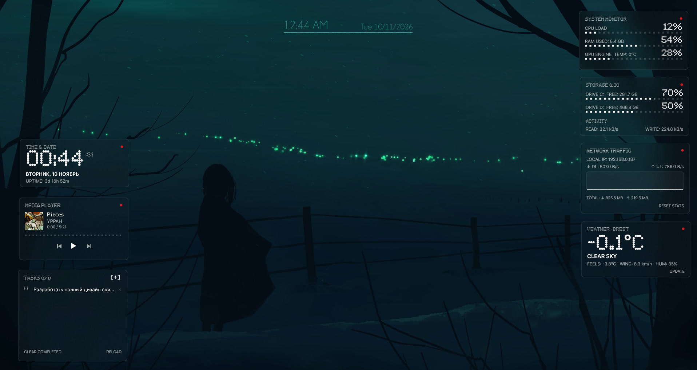

<div align="center">


# NOTHING TRANSPARENT SUITE

**Комплекс прозрачных монохромных виджетов для Rainmeter в аутентичной эстетике Nothing OS.**

[](https://www.rainmeter.net/)
[](https://docs.rainmeter.net/manual/settings/rainmeter-section/#UseD2D)
[](LICENSE)
[](release/)
[](https://github.com/D1verlin)
[-lightgrey?style=flat-square)](https://microsoft.com/windows)

[**[English Readme]**](README.md) · [**[Русская документация]**](README_RU.md) · [**[Скачать .rmskin]**](release/NothingTransparentSuite-v1.0.0.rmskin)

---



</div>

---

## ✦ Особенности комплекса

- **Аутентичный стиль Nothing OS**: Глубокие полупрозрачные поверхности с эффектом матового стекла (Frosted Glass Acrylic), сверхтонкие рамки в 1 пиксель (`#FFFFFF26`), точечные светодиодные матричные шкалы и фирменный акцент Nothing Red (`#D71920`).
- **Аппаратное ускорение Direct2D**: Все 8 виджетов работают в режиме `UseD2D=1` и `AccurateText=1`, обеспечивая безупречный субпиксельный рендеринг шрифтов и гладкую векторную графику без нагрузки на CPU.
- **8 законченных модулей**: Часы и аптайм, Монитор системы (CPU/RAM/GPU), Накопители и скорость IO, Интерактивный список дел (Todo на Lua), Трафик сети с графиком, Медиаплеер, Погода Open-Meteo и Док быстрого запуска.
- **Фирменное приложение NothingConfig v2**: Полнофункциональная программа настройки на WPF (.NET 9) в Bento-стилистике с живым превью, переключателями и полным русским языком.
- **Умная геолокация в 1 клик**: Автоматическое определение города и координат по IP (`ip-api.com`) и умный поиск любого города на русском языке через Open-Meteo.
- **Поддержка браузерных и локальных плееров**: Интеграция с `WebNowPlaying` (YouTube, Яндекс.Музыка, VK, Spotify Web) и локальными плеерами с векторными кнопками управления.
- **Никаких прямоугольных ореолов**: Точное сопоставление физических границ окон Rainmeter с карточками предотвращает артефакты размытия Windows DWM.

---

## ✦ Описание виджетов

| Виджет | Файл скина | Описание и функционал |
| :--- | :--- | :--- |
| **Часы (Clock)** | `Clock\Clock.ini` | Крупные матричные цифры времени (`NDot 57`), день недели, дата, аптайм системы. Клик по красной точке открывает программу настроек `NothingConfig`. |
| **Система (System)** | `System\System.ini` | Мониторинг нагрузки CPU%, используемой памяти RAM (в ГБ и %) и 3D-движка видеокарты GPU со светодиодными матричными шкалами. |
| **Диски (Disks)** | `Disks\Disks.ini` | Свободное место и процент использования двух дисков (C: и D:). Реальная скорость чтения и записи в `МБ/с`, `КБ/с`. Клик по диску открывает Проводник. |
| **Задачи (Todo)** | `Todo\Todo.ini` | Интерактивный список дел на Lua. Клик левой кнопкой — вычеркнуть задачу, правой — удалить, кнопка `[+]` — добавить новую задачу через диалоговое окно. |
| **Сеть (Network)** | `Network\Network.ini` | Локальный IP, текущая скорость скачивания и отдачи, непрерывный векторный график активности и счетчик суммарного трафика за сессию. |
| **Плеер (Player)** | `Player\Player.ini` | Трекинг веб- и локальных плееров. Обложка альбома, название трека, исполнитель, интерактивная шкала перемотки и векторные кнопки Prev / Play / Next. |
| **Погода (Weather)** | `Weather\Weather.ini` | Работает через бесплатный API Open-Meteo без ключей. Крупная температура, погодные условия, температура комфорта, скорость ветра и влажность. |
| **Док (Launcher)** | `Launcher\Launcher.ini` | Сетка 2×3 матовых кнопок для быстрого запуска программ, папок и сайтов. Шестая кнопка запускает конфигуратор. |

---

## ✦ Быстрая установка

### Способ 1: Пакет автоустановки .rmskin (Рекомендуется)
1. Скачайте файл [**`NothingTransparentSuite-v1.0.0.rmskin`**](release/NothingTransparentSuite-v1.0.0.rmskin).
2. Запустите его двойным кликом мыши.
3. В окне Rainmeter Skin Installer нажмите кнопку **Install**.
4. Все виджеты, шрифты (`NDot 55`, `NDot 57`, `Inter`) и плагины (`FrostedGlass.dll`, `WebNowPlaying.dll`) установятся автоматически.

### Способ 2: Ручная установка
1. Скопируйте папку `src/Rainmeter/Skins/NothingTransparentSuite` в директорию скинов Rainmeter:
   ```text
   Документы\Rainmeter\Skins\NothingTransparentSuite
   ```
2. Установите шрифты из папки `@Resources\Fonts` в Windows.
3. Кликните правой кнопкой мыши по значку Rainmeter в трее и выберите **Обновить всё** (Refresh All).

---

## ✦ Дизайн-система и токены оформления

| Токен | Значение RGBA | Применение в интерфейсе |
| :--- | :--- | :--- |
| `ColorPrimary` | `255,255,255,255` | 100% белый для часов, заголовков, активных индикаторов |
| `ColorSecondary` | `255,255,255,160` | 63% белый для подписей, вторичных текстов и подсказок |
| `ColorMuted` | `255,255,255,45` | 18% белый для фоновых шкал прогресс-баров |
| `ColorGlassBg` | `14,14,14,120` | Тонированная полупрозрачная подложка карточек |
| `ColorBorder` | `255,255,255,38` | Тонкая 1px обводка карточки из матового стекла |
| `ColorAccent` | `215,25,32,255` | Фирменная красная точка Nothing OS (`#D71920`) |
| `ColorDone` | `255,255,255,90` | Цвет выполненных (вычеркнутых) задач |

---

## ✦ Дополнительная документация

- [**Инструкция по установке (INSTALLATION.md)**](docs/INSTALLATION.md) — Системные требования, расширение браузера WebNowPlaying, шрифты.
- [**Руководство по настройке (CONFIGURATION.md)**](docs/CONFIGURATION.md) — Все параметры файла `Variables.inc` и возможности приложения NothingConfig.
- [**Справочник по виджетам (WIDGETS.md)**](docs/WIDGETS.md) — Подробный разбор мер, метров и внутренней механики скинов.
- [**Устранение неполадок (TROUBLESHOOTING.md)**](docs/TROUBLESHOOTING.md) — Решение вопросов с размытием, сенсорами GPU и погодой.

---

## ✦ Лицензия

Проект распространяется под открытой лицензией [MIT License](LICENSE).
Rainmeter лицензирован под GNU General Public License v2.
Шрифт Inter распространяется под лицензией SIL Open Font License.
Шрифты семейства NDot являются собственностью Nothing Technology Limited.
